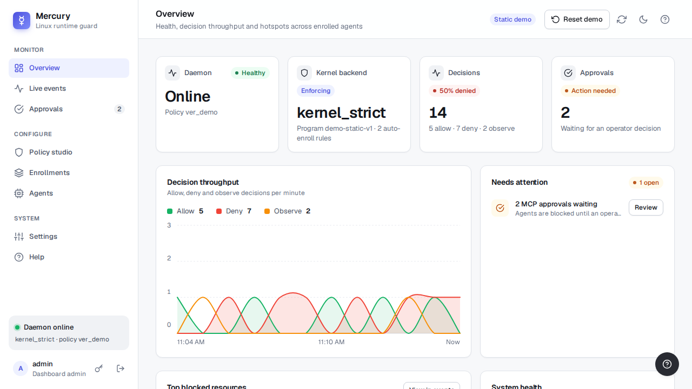

# Mercury

Mercury provides Linux runtime controls for enrolled AI agents. It combines eBPF LSM
enforcement, a Rust policy engine, URL and MCP policies, audit logging, and an operations
dashboard.

## Live Demo

Explore the hosted Mercury dashboard demo on GitHub Pages:

<https://upgraded-adventure-r3gn15y.pages.github.io/>

The demo auto-signs into seeded data so you can click through the dashboard without installing
Mercury locally.

[](https://upgraded-adventure-r3gn15y.pages.github.io/)

## Contents

- [Live Demo](#live-demo)
- [Quick Install](#quick-install)
- [Scope and Current State](#scope-and-current-state)
- [Architecture Overview](#architecture-overview)
- [Runtime Flows](#runtime-flows)
- [Linux Prerequisites](#linux-prerequisites)
- [Build, Test, and Developer Workflow](#build-test-and-developer-workflow)
- [Configuration Reference](#configuration-reference)
- [Policy Model](#policy-model)
- [AI Policy Authoring](#ai-policy-authoring)
- [CLI Reference](#cli-reference)
- [Systemd Deployment](#systemd-deployment)
- [Observability and Logs](#observability-and-logs)
- [Troubleshooting](#troubleshooting)
- [Security Notes](#security-notes)
- [Current Limitations](#current-limitations)
- [Versioning and Releases](#versioning-and-releases)
- [Repository Layout](#repository-layout)
- [Repository Pointers](#repository-pointers)

## Quick Install

Linux `x86_64` installs are published as GitHub Release assets.

1. Download `install-mercury-linux.sh` from the release you want.
2. Inspect it, then optionally verify it against the signed `SHA256SUMS` / `SHA256SUMS.sig`
   assets from the same release.
3. Run the built-in preflight check.
4. Run the installer as root.

```bash
chmod +x ./install-mercury-linux.sh
./install-mercury-linux.sh --preflight-only
sudo ./install-mercury-linux.sh
```

`mercury-status preflight` reports both `supported=true|false` and a support contract tier:
`support_level=fully_tested|compatible|unsupported`. The current tested release target is
`ubuntu-24.04-x86_64`.

The installer downloads `mercury-linux-x86_64.tar.gz` from the matching release tag, verifies the
signed checksum file before trusting the payload, preserves existing `/etc/mercury/config.yaml`
and `/etc/mercury/policy.yaml`, and writes updated defaults as `.new` files during upgrades.

Uninstall while preserving config and runtime data:

```bash
sudo ./install-mercury-linux.sh --uninstall
```

Purge `/etc/mercury`, `/var/lib/mercury`, and `/var/log/mercury` too:

```bash
sudo ./install-mercury-linux.sh --uninstall --purge
```

## Scope and Current State

Mercury on Linux currently provides:

- A production control plane: `mercuryd`, `mercury-run`, `mercury-policy`, `mercury-status`
- Policy parsing, validation, evaluation, and kernel IR compilation in Rust
- eBPF program loading and attachment through Aya
- Kernel event capture via ring buffer and daemon audit ingestion
- Process enrollment through `mercury-run` plus optional auto-enrollment via cgroup pattern scan
- Full URL policy through a local HTTP(S) gateway
- Structured JSONL audit logs, journald mirroring, and dashboard event streaming
- A dashboard-backed operations API with SQLite-backed policy drafts, version history, action logs,
  MCP approval queues, and launched-agent tracking

### Implementation Status

- Implemented: kernel hook attach, event ingestion, and audit pipeline
- Implemented: userspace policy decisions through `mercury-policy test` and the daemon evaluator
- Implemented: policy reload, epoch swap bookkeeping, and policy IR compilation
- Implemented: URL-aware allow/deny through the local gateway
- Implemented: anti-bypass guardrails for URL-enforced profiles
- Implemented: dashboard, installers, and systemd deployment artifacts

Mercury is Linux-only today. The recommended backend is `kernel_strict`; `linux_compat` is also
available for AppArmor-capable hosts that cannot satisfy full eBPF LSM prerequisites. There is
still no ptrace/userspace fallback.

## Architecture Overview

### Control and Data Plane Topology

```text
Clients
-------
  mercury-run --profile <p> -- <cmd>     mercury-policy reload/test     mercury-status/dashboard
                 \                         |                          /
                  \                        |                         /
                   +-----------------------+------------------------+
                                           |
                                           v
                         Unix socket: /run/mercury/mercuryd.sock
                                           |
                                           v
  +----------------------------------------------------------------------------------+
  | mercuryd (root, systemd unit)                                                   |
  |----------------------------------------------------------------------------------|
  | Control API server  | PolicyEngine | URL Gateway | LinuxAdapter | KernelRuntime |
  | Enrollment state    | Policy epoch swap + map sync | Audit logger | Dashboard   |
  +---------------------+-------------------------------+------------------------------+
             |                          |                               |
             | auto-enroll scan         | load/attach + map updates      | event ingest
             v                          v                               v
  /sys/fs/cgroup/**/cgroup.procs   +-----------------------------------------------+
                                    | Linux kernel (BPF LSM + tracepoints)         |
                                    |-----------------------------------------------|
                                    | LSM hooks:                                    |
                                    |   file_open | path_unlink | bprm_check_security |
                                    |   socket_connect                                |
                                    | Tracepoints:                                   |
                                    |   sched_process_fork | sched_process_exec      |
                                    |   sched_process_exit                           |
                                    | BPF maps:                                      |
                                    |   mercury_enrolled_pids  mercury_profiles      |
                                    |   mercury_file_rules     mercury_exec_rules    |
                                    |   mercury_net_rules      mercury_offsets       |
                                    |   mercury_ignored_pids   mercury_stats         |
                                    |   mercury_events (ring buffer)                 |
                                    +---------------------------+---------------------+
                                                                |
                                                                | periodic drain (~200ms)
                                                                v
                                        +------------------------------------------+
                                        | Audit pipeline                            |
                                        | - /var/log/mercury/audit.jsonl          |
                                        | - journald mirror                         |
                                        | - dashboard event stream                  |
                                        +------------------------------------------+

                 URL Gateway (full URL policy)
                 ------------------------------
                 enrolled workload
                   -> HTTP_PROXY / HTTPS_PROXY (mercury-run injected)
                   -> 127.0.0.1:<gateway-port>
                   -> HTTP request parse OR HTTPS CONNECT interception
                   -> evaluate `url_deny` then `url_allow` (deny > allow > default)
                   -> emit URL-rich network audit event (full_url/scheme/method/path/query)
                   -> forward upstream on allow, return 403 on deny

                 Kernel anti-bypass for URL profiles
                 ------------------------------------
                 when profile has URL rules:
                   allow loopback TCP egress only to configured gateway port
                   allow explicit `network_allow` exceptions
                   deny all other direct outbound connect attempts
```

### Enrollment and Decision Flow

```text
mercury-run --profile default -- <cmd>
  -> RegisterAgent(pid, uid, gid, profile, cmdline, cwd)
  -> daemon assigns agent_id/cgroup_id and records enrollment metadata
  -> daemon writes pid to /sys/fs/cgroup/mercury/agents/ai-<id>/cgroup.procs
  -> runtime syncs mercury_enrolled_pids map
  -> <cmd> executes; descendants inherit enrollment via sched_process_fork

On each hooked operation (file/exec/net/delete):
  -> lookup mercury_enrolled_pids[pid]
  -> lookup mercury_profiles[profile_index]
  -> evaluate against class rule maps (file/exec/net + workspace roots)
  -> apply enforcement mode for class (enforce vs observe)
  -> produce decision/reason/action/resource record
  -> emit RawKernelEvent to mercury_events ring buffer
  -> daemon drains ring buffer, converts to AuditEvent, persists/logs/serves
```

## Runtime Flows

### Daemon Startup

```text
mercuryd
  -> load config YAML
  -> initialize Linux adapter
  -> kernel runtime start:
       - check Linux >= 6.1
       - check bpffs path exists
       - check BPF LSM enabled
       - check cgroup v2
       - load embedded eBPF object
       - attach LSM + tracepoint programs
  -> load initial policy via policy-engine
  -> serve Unix socket + periodic kernel event drain
```

### Process Enrollment (`mercury-run`)

```text
mercury-run --profile default -- <cmd>
  -> connect /run/mercury/mercuryd.sock
  -> send RegisterAgent(pid, uid, gid, profile, cmdline, cwd)
  -> daemon assigns agent_id + cgroup_id
  -> daemon writes pid into /sys/fs/cgroup/mercury/agents/ai-<id>/cgroup.procs
  -> daemon stores enrollment metadata
  -> mercury-run execs target command with:
       MERCURY_AGENT_ID
       MERCURY_PROFILE
       MERCURY_CGROUP_ID
       HTTP_PROXY / http_proxy
       HTTPS_PROXY / https_proxy
       NO_PROXY / no_proxy
       SSL_CERT_FILE
       REQUESTS_CA_BUNDLE
       NODE_EXTRA_CA_CERTS
       CURL_CA_BUNDLE
       GIT_SSL_CAINFO
```

### Auto-Enrollment

```text
config.kernel.auto_enroll_rules[*]
  -> every scan, daemon walks cgroup_root/**/cgroup.procs
  -> glob-match path against cgroup_pattern
  -> read pids from matching cgroup.procs
  -> create enrollment entries with source=auto_enroll
```

### Policy Reload

```text
mercury-policy --socket ... reload --file policy.yaml
  -> daemon validates + compiles policy
  -> compile_kernel_ir(policy)
  -> create new epoch (inactive -> active swap)
  -> retain active + previous epoch
  -> update userspace evaluator policy
```

### Kernel Event to Audit Flow

```text
Kernel hook hit
  -> eBPF program emits RawKernelEvent to mercury_events ringbuf
  -> daemon tick (200ms) drains ringbuf
  -> decode RawKernelEvent -> AuditEvent
  -> write JSONL (+ journald mirror if enabled)
```

### Local MCP `stdio` Flow

```text
client launches local MCP server subprocess
  -> call RegisterMcpServer(pid, profile, server_id, client_name, parent_agent_id)
  -> daemon validates server_id against profile.mcp.servers[*].exec_path_glob
  -> daemon enrolls the server process and returns agent_id + cgroup_id + mcp_session_id

before each tools/call
  -> client calls AuthorizeMcpToolCall(mcp_session_id, tool_name, tool_call_id, arguments_json)
  -> daemon returns allow | deny | pending_approval
  -> if pending_approval, dashboard operator approves or denies the request
  -> client waits through WaitMcpApproval(request_id)
  -> daemon emits one MCP semantic audit event on final allow/deny
  -> file / exec / network / URL side effects from the enrolled server are stamped with MCP context

after tool return
  -> client calls CompleteMcpToolCall(mcp_session_id, tool_call_id, status)
  -> daemon clears the active MCP tool-call context
```

### MCP HTTP Gateway Flow

```text
client registers an MCP HTTP server profile
  -> call RegisterMcpServer(pid, profile, server_id, client_name, parent_agent_id)
  -> daemon validates server_id against profile.mcp.servers[*].base_url
  -> daemon returns mcp_session_id + mcp_http_gateway_url + mcp_http_gateway_token

client sends JSON-RPC to the Mercury gateway URL
  -> tools/call is checked against MCP tool policy
  -> resources/read is checked against MCP resource policy
  -> if require_approval, Mercury waits for dashboard approval before forwarding
  -> approved requests are forwarded to the configured upstream base_url
  -> final allow / deny is audited under MCP semantic events
```

## Linux Prerequisites

### Kernel and Runtime Requirements

- Linux kernel `>= 6.1`
- BPF LSM enabled in the kernel LSM list
- bpffs mounted, usually at `/sys/fs/bpf`
- cgroup v2 mounted, with `/sys/fs/cgroup/cgroup.controllers` present

Quick checks:

```bash
uname -r
test -d /sys/fs/bpf && echo "bpffs ok"
test -f /sys/fs/cgroup/cgroup.controllers && echo "cgroup v2 ok"
grep -q '\bbpf\b' /sys/kernel/security/lsm && echo "bpf lsm ok"
```

### Build Requirements

- Rust toolchain with `cargo`
- `clang` with the BPF target

Quick checks:

```bash
clang --version
llc --version | rg bpf
```

## Build, Test, and Developer Workflow

### Build

```bash
cargo build --workspace
```

Linux kernel object generation requires `clang` with the `bpf` target.

### Test

```bash
cargo test --workspace
```

### Quality Commands

Run repo-wide checks from the repository root:

```bash
make format-check
make lint
make test
```

Dashboard UI checks:

```bash
npm --prefix dashboard/linux-ui run lint
npm --prefix dashboard/linux-ui run typecheck
npm --prefix dashboard/linux-ui run test
```

Kernel enforcement harness on a Linux host with the required privileges:

```bash
make test-kernel
```

### Repo-Local Install from Source

If you are building from source instead of GitHub Releases:

```bash
cargo build --release --workspace
npm --prefix dashboard/linux-ui ci
npm --prefix dashboard/linux-ui run build
sudo ./scripts/install_mercury_system.sh --preflight-only
sudo ./scripts/install_mercury_system.sh
```

The installer keeps the dashboard on `127.0.0.1:7480` by default. To expose it intentionally,
pass `--dashboard-expose` or `--dashboard-bind-addr <addr>`.

Non-loopback dashboard binds require a trusted TLS certificate. Use `--acme-domain` /
`--acme-email` or `--tls-cert-file` / `--tls-key-file`, or keep Mercury on localhost behind a
reverse proxy.

If you explicitly want Mercury's self-signed certificate on a non-loopback bind, pass
`--dashboard-allow-self-signed` together with `--dashboard-expose` or `--dashboard-bind-addr`.

The repo-local installer uses the same helpers as the release installer, preserves existing
`/etc/mercury` files by writing `.new` siblings instead of overwriting them, and stops on failed
preflight unless you explicitly pass `--force`.

Remove a repo-local install while preserving config and runtime data:

```bash
sudo ./scripts/uninstall_mercury_system.sh
```

### Developer Quickstart

1. Build release binaries.

```bash
cargo build --release --workspace
```

2. Build the dashboard bundle.

```bash
npm --prefix dashboard/linux-ui ci
npm --prefix dashboard/linux-ui run build
```

3. Install locally.

```bash
sudo ./scripts/install_mercury_system.sh
```

4. Start the daemon manually if you are not using the systemd installer path.

```bash
sudo ./target/release/mercuryd --config /etc/mercury/config.yaml
```

5. Validate and reload policy.

```bash
./target/release/mercury-policy validate --file samples/policy.yaml
./target/release/mercury-policy --socket /run/mercury/mercuryd.sock reload --file /etc/mercury/policy.yaml
```

6. Launch a command under policy.

```bash
./target/release/mercury-run --profile default -- /usr/bin/env
```

7. Check daemon status.

```bash
./target/release/mercury-status --socket /run/mercury/mercuryd.sock
```

### Dashboard UI Build

Build the dashboard bundle:

```bash
npm --prefix dashboard/linux-ui ci
npm --prefix dashboard/linux-ui run build
```

Then point daemon config `dashboard.static_dir` to the build output:

```yaml
dashboard:
  static_dir: /path/to/repo/dashboard/linux-ui/dist
```

Static hosted demo build, no daemon required:

```bash
npm --prefix dashboard/linux-ui ci
npm --prefix dashboard/linux-ui run build:demo
```

This writes a fixture-backed guided demo to `docs/demo/`. The static build auto-authenticates,
seeds every dashboard tab with local demo data, and keeps edits and approvals in browser memory so
users can click through the interface without installing Mercury.

Preview the generated bundle locally:

```bash
npm --prefix dashboard/linux-ui run preview:demo
```

The repo includes a GitHub Pages workflow at
[`github-pages-demo.yml`](./.github/workflows/github-pages-demo.yml). Once Pages is configured to
use GitHub Actions in repository settings, pushes to `main` publish the static demo as the site
root.

Frontend end-to-end coverage is also available:

```bash
npm --prefix dashboard/linux-ui run e2e
```

For a feature-by-feature matrix and runtime action gap audit, see [docs/e2e-coverage.md](./docs/e2e-coverage.md).

Dashboard auth bootstrap options:

1. First-run signup, if `/etc/mercury/dashboard.password` is missing.
2. CLI rotation, for forgotten password or pre-provisioning:

```bash
mercury-policy dashboard-password rotate --file /etc/mercury/dashboard.password --username admin
```

The CLI command prints one-time credentials and overwrites the stored password hash.

`mercury-policy dashboard-token rotate` remains available as a compatibility alias for the same
credential-rotation flow.

### Dashboard Operator Workflows

The dashboard is more than a static status page. The current UI and API support:

- Overview metrics for daemon, kernel backend, URL gateway, dashboard readiness, ingest backlog,
  and top blocked resources
- Live Events with historical queries plus SSE updates from `/api/v1/events/stream`
- One-click quick rules from file, exec, and network events to create exact allow or deny entries
- MCP approval queues for `require_approval` tool calls
- Policy Studio draft persistence, validation, diff review, apply notes, version history, and
  rollback
- Agent launch, list, and stop controls for commands started from the dashboard under named
  profiles
- Settings-driven TLS hot-swap with current certificate metadata surfaced in the UI
- Operator action history for logins, policy changes, approvals, quick rules, and agent lifecycle
  events, with CSV export
- A built-in Help Hub and guided tour for operator onboarding

Dashboard agent launch runs `mercury-run` as the configured non-root Linux user and is best for
long-running server-style agents and background workers. If you launch a `smolagents` or
`LangChain` app that exposes its own web UI or API, interact with that service directly after
launch. Interactive terminal or chat programs are not a good fit for the dashboard launcher today;
use `mercury-run` from a shell when you need interactive stdin/stdout behavior.

### Dashboard Auth and API

- First-run signup is enabled when `dashboard.auth.password_file` does not yet exist.
- Mutating dashboard API routes require both the `dashboard_session` cookie and `X-CSRF-Token`.
- Login, signup, and password-change flows share the same brute-force budget: 5 failed attempts in
  10 minutes trigger a 15-minute per-IP lockout.
- All dashboard routes are subject to per-IP request rate limiting via
  `dashboard.request_rate_limit_rps`.
- Password changes revoke all active dashboard sessions before issuing a fresh one.
- The dashboard exposes an OpenAPI document at `/api/v1/swagger.json` and an unauthenticated
  liveness probe at `/api/v1/health`.

### Open-Source Agent Harness

This repo includes reusable open-source agent policy tests:

Kernel-dependent validation runs locally; see
[docs/local-kernel-testing.md](docs/local-kernel-testing.md) for prerequisites
and the release smoke's disposable-host requirement.

- [`samples/oss-agents/run_smolagents_policy_test.sh`](samples/oss-agents/run_smolagents_policy_test.sh)
- [`samples/oss-agents/smolagents_file_deny.py`](samples/oss-agents/smolagents_file_deny.py)
- [`samples/oss-agents/smolagents_net_deny.py`](samples/oss-agents/smolagents_net_deny.py)
- [`samples/oss-agents/run_major_agents_policy_test.sh`](samples/oss-agents/run_major_agents_policy_test.sh)
- [`samples/oss-agents/benchmark_kernel_overhead.sh`](samples/oss-agents/benchmark_kernel_overhead.sh)

Run:

```bash
./samples/oss-agents/run_smolagents_policy_test.sh
TIMEOUT_SECS=900 ./samples/oss-agents/run_major_agents_policy_test.sh
./samples/oss-agents/benchmark_kernel_overhead.sh
```

The `smolagents` harness starts `mercuryd` with a temporary policy, runs agent tests under
`mercury-run`, and prints deny evidence such as `/etc/hosts` and outbound `1.1.1.1:80` denials.

## Configuration Reference

Mercury daemon config lives at `/etc/mercury/config.yaml`.

Reference example: [`samples/config.yaml`](samples/config.yaml)

```yaml
socket_path: /run/mercury/mercuryd.sock
policy_path: /etc/mercury/policy.yaml
audit_jsonl_path: /var/log/mercury/audit.jsonl
log_level: info
mirror_to_journald: true
signature_verification: require_valid
signature_key_path: /etc/mercury/policy-signing-key
policy_unavailable_mode: fail_closed
backend_mode: kernel_strict
cgroup_base: /sys/fs/cgroup/mercury/agents
kernel:
  bpffs_path: /sys/fs/bpf
  cgroup_root: /sys/fs/cgroup
  event_buffer_pages: 256
  url_proxy_port: 19080
  auto_enroll_rules:
    - id: ide-agent
      cgroup_pattern: "**/user.slice/**/code-*.scope/cgroup.procs"
      profile: default
      mode: enforce
  unmatched_host_mode: observe
url_gateway:
  enabled: true
  required: true
  bind_addr: 127.0.0.1:19080
  no_proxy: localhost,127.0.0.1,::1
  tls_intercept_enabled: true
  ca_cert_file: /etc/mercury/url-gateway-ca.crt
  ca_key_file: /etc/mercury/url-gateway-ca.key
  auto_generate_ca: true
  connect_timeout_ms: 10000
  request_timeout_ms: 30000
dashboard:
  enabled: true
  required: false
  bind_addr: 127.0.0.1:7480
  static_dir: /usr/share/mercury/dashboard
  sqlite_path: /var/lib/mercury/dashboard.db
  retention_days: 14
  sse_clients_max: 200
  request_rate_limit_rps: 50
  auth:
    username: admin
    password_file: /etc/mercury/dashboard.password
    session_ttl_minutes: 30
  tls:
    enabled: true
    cert_file: /etc/mercury/dashboard.crt
    key_file: /etc/mercury/dashboard.key
    auto_generate_self_signed: true
```

The built-in dashboard default bind address is `127.0.0.1:7480`. Expose it intentionally by
setting `dashboard.bind_addr` to `0.0.0.0:7480` or a specific interface, ideally behind a reverse proxy.

### Config Fields

Core fields:

| Field | Meaning |
|---|---|
| `socket_path` | Unix socket for the local control API |
| `policy_path` | Startup policy file path |
| `audit_jsonl_path` | Append-only audit log path |
| `log_level` | Tracing level such as `info` or `debug` |
| `mirror_to_journald` | Mirror each audit entry to journald or syslog |
| `signature_verification` | `disabled`, `warn_on_invalid`, or `require_valid` |
| `signature_key_path` | Optional hex-encoded HMAC key file used for required signature validation and daemon-side re-signing |
| `signature_key_id` | Key identifier written when the daemon persists an auto-signed policy |
| `policy_unavailable_mode` | Fail behavior if policy is unavailable: `fail_open` or `fail_closed` |
| `backend_mode` | Linux backend mode, currently `kernel_strict` |
| `cgroup_base` | Root for per-agent cgroup placement |
| `kernel.bpffs_path` | bpffs mount location used by kernel runtime checks |
| `kernel.cgroup_root` | cgroup root used for auto-enroll scanning |
| `kernel.event_buffer_pages` | Ring or event buffer sizing knob |
| `kernel.url_proxy_port` | Gateway port injected into enrolled processes and used by kernel anti-bypass rules for URL-governed profiles |
| `kernel.auto_enroll_rules[]` | cgroup path pattern to profile mapping |
| `kernel.unmatched_host_mode` | Behavior for unmatched host processes, currently `observe` |

URL gateway fields:

| Field | Meaning |
|---|---|
| `url_gateway.enabled` | Enable the local HTTP(S) proxy used for full URL policy |
| `url_gateway.required` | Fail daemon startup if the URL gateway cannot initialize |
| `url_gateway.bind_addr` | Listener address used for injected `HTTP_PROXY` / `HTTPS_PROXY` values |
| `url_gateway.no_proxy` | `NO_PROXY` value injected into enrolled processes |
| `url_gateway.tls_intercept_enabled` | Enable HTTPS CONNECT interception so URL rules can inspect host, path, query, and method |
| `url_gateway.ca_cert_file` | Local CA certificate path used for intercepted TLS traffic |
| `url_gateway.ca_key_file` | Private key path for the local CA |
| `url_gateway.auto_generate_ca` | Auto-create the gateway CA material when missing |
| `url_gateway.connect_timeout_ms` | Upstream TCP connect timeout for proxied requests |
| `url_gateway.request_timeout_ms` | End-to-end timeout for proxied requests |
| `url_gateway.upstream_ca_cert_file` | Optional extra CA bundle trusted when Mercury connects upstream |

Dashboard fields:

| Field | Meaning |
|---|---|
| `dashboard.enabled` | Enable the built-in operator dashboard and admin API |
| `dashboard.required` | Fail daemon startup if the dashboard cannot initialize |
| `dashboard.bind_addr` | Dashboard listener address; built-in default is loopback-only `127.0.0.1:7480` |
| `dashboard.static_dir` | Directory that serves the bundled frontend assets |
| `dashboard.sqlite_path` | SQLite state store for events, sessions, drafts, policy versions, actions, and approvals |
| `dashboard.retention_days` | Retention window for stored dashboard history before pruning |
| `dashboard.sse_clients_max` | Maximum concurrent live-event SSE subscribers |
| `dashboard.request_rate_limit_rps` | Per-IP dashboard request budget |
| `dashboard.auth.username` | Admin username expected by login and signup flows |
| `dashboard.auth.password_file` | Argon2 password-hash file for the dashboard admin account; legacy `token_file` is accepted as an alias |
| `dashboard.auth.session_ttl_minutes` | Dashboard session lifetime |
| `dashboard.launch.user` | Non-root Linux username used when the Agents tab launches `mercury-run` |
| `dashboard.launch.group` | Optional primary group override for dashboard-launched agents |
| `dashboard.launch.launcher_path` | Optional absolute path override for the `mercury-run` launcher binary |
| `dashboard.launch.history_limit` | Maximum number of completed or failed launches kept in dashboard memory |
| `dashboard.tls.enabled` | Serve the dashboard over HTTPS |
| `dashboard.tls.cert_file` | PEM certificate path for the dashboard listener |
| `dashboard.tls.key_file` | PEM private key path for the dashboard listener |
| `dashboard.tls.auto_generate_self_signed` | Auto-generate a self-signed dashboard certificate when the configured files are missing |

## Policy Model

Mercury policy lives at `/etc/mercury/policy.yaml`.

Reference example: [`samples/policy.yaml`](samples/policy.yaml)

High-level semantics:

- Deny rules are checked before allow rules
- Class-specific enforcement supports `observe` and `enforce`
- Default decision fallback is `allow` or `deny`
- Policies are profile-scoped
- `workspace_roots` can grant broad workspace access
- Top-level `rules` is not supported; rules live under profiles

### Rule Classes

- `file_allow` / `file_deny`: glob path patterns
- `exec_allow` / `exec_deny`: executable path patterns
- `network_allow` / `network_deny`: `cidr`, `protocol`, optional `port`, optional `host_glob`
- `url_allow` / `url_deny`: `scheme`, `host_glob`, optional `port`, optional `method`,
  `path_glob`, optional `query_glob`
- `mcp`: optional semantic policy for `stdio` and `http` MCP servers, tool names, and resource
  URI globs

### MCP Policy

When `profiles.<name>.mcp` is absent, Mercury's existing file / exec / network / URL controls
still apply and MCP semantic authorization defaults to allow.

When `profiles.<name>.mcp` is present:

- tool precedence is `explicit tool rule -> server default_tool_action -> profile default_tool_action`
- resource precedence is `explicit resource rule -> server default_resource_action -> profile default_resource_action`
- supported actions are `allow`, `deny`, and `require_approval`
- supported transports are `stdio` and `http`
- `exec_path_glob` binds a declared `server_id` to the resolved server executable path for `stdio`
- `base_url` binds a declared `server_id` to the upstream MCP endpoint for `http`
- HTTP MCP registration returns a Mercury gateway URL plus a per-session bearer token; clients
  point at Mercury, and Mercury forwards `tools/call`, `resources/read`, `prompts/list`, and
  `prompts/get` only after semantic policy and approval checks
- approval requests are per-call with a 300-second default expiry

Example:

```yaml
version: v1
defaults:
  decision: deny
profiles:
  default:
    mcp:
      default_tool_action: deny
      default_resource_action: deny
      servers:
        - id: github
          transport: stdio
          exec_path_glob: /usr/local/bin/github-mcp*
          default_tool_action: require_approval
          default_resource_action: require_approval
          tools:
            allow: [list_repos, get_issue]
            deny: [delete_repo]
            require_approval: [create_pull_request]
          resources:
            allow: [repo://openai/mercury/issues/**]
            deny: [repo://openai/mercury/secrets/**]
            require_approval: [repo://openai/mercury/pulls/**]
```

### Enforcement Coverage

Mercury now reports per-surface coverage through daemon health/status. The practical tiers are:

| Surface | `kernel_strict` | `linux_compat` |
| --- | --- | --- |
| File read/write/delete/mmap/mutation | enforced | AppArmor; inherited-descriptor mmap gap below |
| Exec | enforced | AppArmor for child exec; initial launch gap below |
| Raw network connect/sendmsg/bind/create | enforced | enforced via AppArmor |
| Raw network `listen` / `accept` | observe-only | enforced via AppArmor |
| `capable` | observe-only | enforced via AppArmor |
| `bpf(2)`, kernel module / kexec load | enforced (explicit `exec_allow` for `<bpf>` / `<kernel-module>` required) | not mediated |
| `mount` / `move_mount`, user namespace creation | enforced as `<mount>` / `<userns>` (hook optional per kernel) | mount denied by AppArmor profiles |
| ptrace attach outside the enrollment, signals to Mercury | refused | per AppArmor profile |
| AF_UNIX connect to a `file_deny` path | enforced | per AppArmor profile |
| URL gateway policy | enforced when gateway is enabled and ready | enforced when gateway is enabled and ready |
| MCP `tools/call` / `resources/read` / `prompts/list` / `prompts/get` | enforced | enforced |

For `filesystem_backend: apparmor`, a local Linux 6.8 test allowed a writable
`MAP_SHARED` mapping of a denied file when the descriptor was opened before
enrollment. Treat inherited-descriptor mmap enforcement as an open gap until a
fix and regression pass; see [docs/e2e-coverage.md](docs/e2e-coverage.md).
The same backend allowed an initial executable listed in `exec_deny` during
the on-exec profile transition; a later child exec was denied. Under heavy
kernel audit suppression, that child denial did not appear in Mercury's audit
log. Treat initial exec denial and AppArmor audit delivery as open gaps until
their focused regression passes.

### Example Policy

```yaml
version: v1
defaults:
  decision: deny
  fail_mode: fail_closed
  audit_level: all
  enforcement:
    file: enforce
    process: enforce
    network: enforce
profiles:
  default:
    workspace_roots:
      - /workspace
    file_allow:
      - id: allow_workspace
        pattern: /workspace/**
    file_deny:
      - id: deny_workspace_secrets
        pattern: /workspace/secrets/**
    exec_allow:
      - id: allow_shell_tools
        path: /usr/bin/*
    network_allow:
      - id: allow_localhost
        cidr: 127.0.0.1/32
        protocol: TCP
```

### Policy Signatures

Mercury can validate and write HMAC-SHA256 policy signatures.

Generate a signing key:

```bash
./target/release/mercury-policy generate-signing-key --key-file /etc/mercury/policy-signing-key
```

Validate a policy with required signatures:

```bash
./target/release/mercury-policy validate \
  --file /etc/mercury/policy.yaml \
  --signature require \
  --key-file /etc/mercury/policy-signing-key
```

Sign a policy:

```bash
./target/release/mercury-policy sign \
  --file /etc/mercury/policy.yaml \
  --key-file /etc/mercury/policy-signing-key \
  --key-id prod-key-2025
```

## AI Policy Authoring

Mercury includes a constrained plain-English-to-policy workflow so models generate structured patch
JSON instead of free-form YAML.

Authoring assets:

- [`docs/ai/README.md`](docs/ai/README.md)
- [`docs/ai/mercury-policy-patch.prompt.md`](docs/ai/mercury-policy-patch.prompt.md)
- [`docs/ai/mercury-policy-patch.schema.json`](docs/ai/mercury-policy-patch.schema.json)
- [`docs/ai/example-policy-patch.json`](docs/ai/example-policy-patch.json)
- [`tools/mercury-policy-patch`](tools/mercury-policy-patch)

Recommended flow:

1. Ask the model for a `mercury-policy-patch/v1` JSON document.
2. Merge it into a real Mercury policy with `mercury-policy-patch`.
3. Validate the rendered YAML with `mercury-policy validate`.
4. Re-sign the rendered policy if your environment requires signatures.

Build the helper:

```bash
cargo build -p mercury-policy-patch
```

Render a patch into an existing policy:

```bash
cargo run -p mercury-policy-patch -- render \
  --policy policy.example.yaml \
  --patch docs/ai/example-policy-patch.json \
  --output /tmp/policy.rendered.yaml
```

If the patch targets a profile that does not exist yet, add `--create-profile`.

Validate the rendered result:

```bash
cargo run -p cli --bin mercury-policy -- validate --file /tmp/policy.rendered.yaml
```

## CLI Reference

### `mercury-policy`

Validate:

```bash
./target/release/mercury-policy validate --file samples/policy.yaml
```

Reload daemon policy:

```bash
./target/release/mercury-policy --socket /run/mercury/mercuryd.sock reload --file /etc/mercury/policy.yaml
```

Test a decision through the daemon evaluator:

```bash
./target/release/mercury-policy --socket /run/mercury/mercuryd.sock test \
  --profile default \
  --action file-read \
  --path /etc/hosts
```

Test MCP semantic policy through the daemon evaluator:

```bash
./target/release/mercury-policy --socket /run/mercury/mercuryd.sock test \
  --profile default \
  --action mcp-tool-call \
  --mcp-server github \
  --mcp-tool list_repos \
  --arguments-json '{"owner":"acme"}'
```

Rotate dashboard password:

```bash
./target/release/mercury-policy dashboard-password rotate \
  --file /etc/mercury/dashboard.password \
  --username admin
```

Compatibility alias:

```bash
./target/release/mercury-policy dashboard-token rotate \
  --file /etc/mercury/dashboard.password \
  --username admin
```

### `mercury-run`

```bash
./target/release/mercury-run --profile default -- /usr/bin/env
```

### `mercury-status`

```bash
./target/release/mercury-status --socket /run/mercury/mercuryd.sock
```

Check dashboard reachability from the CLI:

```bash
./target/release/mercury-status --dashboard
```

Run an installer-free host preflight:

```bash
./target/release/mercury-status preflight
./target/release/mercury-status preflight --json
```

Typical fields:

- `backend_mode=kernel_strict`
- `kernel_ready=true|false`
- `kernel_program_version=...`
- `auto_enroll_active_rules=<n>`
- `unmatched_mode=observe`
- `dashboard_enabled=true|false`
- `dashboard_ready=true|false`
- `dashboard_url=...`
- `url_gateway_enabled=true|false`
- `url_gateway_ready=true|false`
- `events_ingested_total=<n>`
- `ingest_backlog_len=<n>`
- `dashboard_schema_version=<n>`
- `pending_mcp_approvals=<n>`
- `active_mcp_sessions=<n>`
- `exec_hook`
- `network_hook`
- `filesystem_hook`

With `--dashboard`, the CLI also prints `dashboard_reachable=true|false`.

## Systemd Deployment

Service file: [`deploy/systemd/mercuryd.service`](deploy/systemd/mercuryd.service)

Key hardening and capability choices:

- `NoNewPrivileges=true`
- strict filesystem protections
- explicit writable paths for runtime, audit, cgroup, and bpffs
- capabilities include `CAP_BPF`, `CAP_PERFMON`, `CAP_SYS_ADMIN`, and `CAP_DAC_READ_SEARCH`

Install with the release installer:

```bash
sudo ./install-mercury-linux.sh
```

For local source builds, `sudo ./scripts/install_mercury_system.sh` installs the same service and
runtime files from repo-built artifacts. It supports `--preflight-only` and `--force`, just like
the signed release installer.

After adding your user to the `mercury` group, start a new login session so group membership
applies before running `mercury-run` without `sudo`.

## Observability and Logs

Default audit file: `/var/log/mercury/audit.jsonl` (one JSON record per line,
HMAC-chained, rotated at `audit_max_file_bytes`), mirrored to journald
(`SYSLOG_IDENTIFIER=mercury`, `MERCURY_*` fields).

Each record contains the timestamp, `agent_id` (the agent run), pid/ppid/uid,
`action_type`, `decision`, `reason`, `rule_id`, the resource, profile and
policy version. Schema v2 adds process context (`tid`, `comm`, `cgroup_id`,
`root_pid`, `parent_agent_id`), exec `argv`, rename source paths, AF_UNIX
socket paths, request outcomes, `correlation_id`s, and `SYSTEM_EVENT` records
for Mercury's own lifecycle and for telemetry loss. Details, including how to
follow one agent run across the kernel, gateway and MCP layers, are in
[`docs/observability/`](docs/observability/README.md).

Quick inspection:

```bash
tail -f /var/log/mercury/audit.jsonl
rg '"decision":"DENY"' /var/log/mercury/audit.jsonl
rg '"event":"telemetry_loss"' /var/log/mercury/audit.jsonl
journalctl -t mercury PRIORITY=4
mercury-audit verify
mercury-status   # exits 2 when telemetry or enforcement is degraded
```

## Troubleshooting

### Daemon Fails at Startup

Check:

```bash
journalctl -u mercuryd -n 200 --no-pager
```

Common causes:

- kernel < 6.1
- bpffs not mounted
- BPF LSM not enabled
- cgroup v2 unavailable
- missing privileges or capabilities under the service manager

### `kernel_ready=false`

- run `mercury-status`
- verify the prerequisite checks in Linux Prerequisites
- verify the service is running as root with the expected capability set

### No Audit Events from Kernel Hooks

- ensure the daemon is running and draining regularly
- confirm the eBPF object includes the expected programs and maps
- validate the ring buffer map name is `mercury_events`

## Security Notes

- Keep `/etc/mercury` root-owned and write-restricted
- Treat policy files as privileged configuration
- Prefer `policy_unavailable_mode: fail_closed` in production
- Forward JSONL and journald outputs to centralized logging or a SIEM
- Follow the backup, rollback, and alerting guidance in [`docs/public-prod.md`](docs/public-prod.md)

## Current Limitations

- `linux_compat` is intentionally narrower than `kernel_strict`; raw non-URL network mediation
  still follows AppArmor semantics there rather than the eBPF LSM path
- MCP v1 now covers `stdio` and `http` transports plus `tools/call`, `resources/read`,
  `prompts/list`, and `prompts/get`, but not sampling or elicitation
- `stdio` MCP still relies on client-side control-socket authorization integration; HTTP MCP
  approvals are enforced directly through the Mercury gateway

## Versioning and Releases

Mercury releases are managed with `release-please`.

- PR titles should use conventional commits such as `feat: ...`, `fix: ...`, or `feat!: ...`
- Pushes to `main` update or create the release PR automatically
- When the release PR merges, the workflow tags `vX.Y.Z`, updates `Cargo.toml`, appends
  `CHANGELOG.md`, and uploads the Linux release assets to GitHub Releases

## Repository Layout

| Component | Path | Responsibility |
|---|---|---|
| Core schema | `crates/core-types` | Canonical action, resource, decision, audit, and policy models |
| Policy engine | `crates/policy-engine` | YAML validation, deterministic matching, and kernel IR compilation |
| Control API | `crates/control-api` | Unix socket request and response framing |
| Audit crate | `crates/audit` | JSONL write, rotation, and journald mirroring |
| Kernel matcher | `crates/kernel-matcher` | Deterministic matcher constants and path glob behavior |
| Kernel object | `crates/kernel-ebpf` | Embedded eBPF C object build and program metadata |
| Kernel runtime | `crates/kernel-runtime` | Aya load and attach, enrollment, epoch tracking, ring buffer drain |
| Linux adapter | `crates/linux-adapter` | Linux enforcement abstraction and capability probing |
| Daemon | `crates/daemon` | Policy authority, control server, audit sink, dashboard integration |
| Launcher | `crates/launcher` | `mercury-run` wrapper |
| CLI | `crates/cli` | `mercury-policy` and `mercury-status` tools |
| Dashboard UI | `dashboard/linux-ui` | React and Vite dashboard |
| AI patch helper | `tools/mercury-policy-patch` | Merge constrained AI-generated JSON patches into Mercury YAML |
| Systemd artifacts | `deploy/systemd` | Service and tmpfiles units |
| Samples | `samples` | Example config, policies, and OSS-agent test harnesses |

## Repository Pointers

- Architecture notes: [`docs/architecture.md`](docs/architecture.md)
- Install and hardening notes: [`docs/install.md`](docs/install.md)
- Public production guide: [`docs/public-prod.md`](docs/public-prod.md)
- AI policy authoring guide: [`docs/ai/README.md`](docs/ai/README.md)
- Example config: [`samples/config.yaml`](samples/config.yaml)
- Example policy: [`samples/policy.yaml`](samples/policy.yaml)

## Acknowledgement

First I would like to thank the All-Mighty God who is the source of all knowledge, without Him, this would not be possible.
